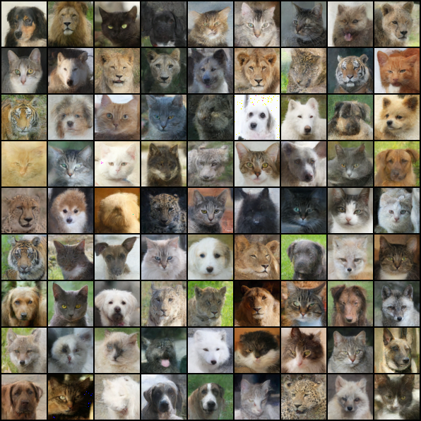

# Denoising Diffusion Implicit Models

DDIM (Denoising Diffusion Implicit Models) is a method to accelerate inference for diffusion-based generative models.

## Installation

```console
git clone https://github.com/bareform/dependencies.git
conda update -n base -c defaults conda
conda env create -f dependencies/environment.yml
conda activate bareform

git clone https://github.com/bareform/ddim.git
cd ddim
```

<details>
  <summary> Dependencies (click to expand) </summary>
  
  ## Dependencies
  - Python 3.10
  - datasets
  - numpy
  - torch
  - torchvision
    
</details>

## Quick Start

To train a low-res `AFHQ` DDPM:

```
python3 -m utils.trainer --config="./configs/afhq.toml"
```

After training for 500K steps, you can find results similiar to the image at `./assets/afhq/afhq.png`.



Using the configuration provided at `./configs/afhq.toml`, we achieve a mean FID score of 19.10 with a standard deviation of 0.286 over 10 runs while only using 100 timesteps during inference.

You can download the pre-trained models [here](https://huggingface.co/luethan2025/ddpm) and use the provided Jupyter Notebook `inference.ipynb` to generate some samples.

## Method

[Denoising Diffusion Implicit Models](https://arxiv.org/abs/2010.02502)

Jiaming Song, Chenlin Meng, Stefano Ermon

Stanford University

> Denoising diffusion probabilistic models (DDPMs) have achieved high quality image generation without adversarial training, yet they require simulating a Markov chain for many steps to produce a sample. To accelerate sampling, we present denoising diffusion implicit models (DDIMs), a more efficient class of iterative implicit probabilistic models with the same training procedure as DDPMs. In DDPMs, the generative process is defined as the reverse of a Markovian diffusion process. We construct a class of non-Markovian diffusion processes that lead to the same training objective, but whose reverse process can be much faster to sample from. We empirically demonstrate that DDIMs can produce high quality samples 10× to 50× faster in terms of wall-clock time compared to DDPMs, allow us to trade off computation for sample quality, and can perform semantically meaningful image interpolation directly in the latent space.

## Citation

The original paper can be found at:
```
@misc{song2020ddim,
    title={Denoising Diffusion Implicit Models},
    author={Jiaming Song and Chenlin Meng and Stefano Ermon},
    year={2020},
    eprint={2010.02502},
    archivePrefix={arXiv},
    primaryClass={cs.LG}
}
```
